# Sprachweg: QA report

QA pass over the whole system (backend + frontend) on 11 Oct 2026. It followed the user stories in [STORY.md](STORY.md)
and the API contract in [PLAN.md](PLAN.md). Every bug below was reproduced in the running system, fixed in code and
re-verified.

## 1. Scope & method

* **Scripted end-to-end runs** with Playwright (Chromium) against the running apps, at **1440 px** desktop and
  **390 px / 360 px** mobile, in **English and German**, **light and dark** (spot checks). Every step was
  screenshotted and reviewed by eye.
* **API-level E2E script** (Node `fetch`, about 150 assertions) for business rules the UI cannot fully show: visibility
  gating, direct URLs to hidden content, attempt limits, grading, capacity, ownership and token handling.
* **Automated checks**: horizontal-scroll and off-screen-control detection at 360 px, clipped-text detection for German
  labels, keyboard tab order, and console errors / HTTP ≥ 500 on every page.

Flows covered:

| Area | What was exercised |
|---|---|
| Visitor | Landing, catalog search / level filter / pagination / no results, course page, 404s, language + theme switchers, mobile menu |
| Accounts | Register student + instructor, inline validation, duplicate e-mail, check-email, verify (valid / reused / invalid / missing token), unverified login + resend, wrong password, forgot / reset password (reuse rejected), login with new password |
| Instructor | Empty states for a new instructor, create course (all fields, rich description, tags, cover upload, capacity), modules, items of **every** type via the add-content menu, uploads (pdf, docx, pptx, txt, mp4, mp3, wav, png), YouTube / embed URLs, quiz with all 6 question types + validation, exam with essay + time limit, keyboard and mouse drag & drop (items, modules, across modules), publish / schedule / auto-unpublish, calendar + agenda, preview as student, grading from a notification |
| Learner | Apply with message, waitlist position, approval notification, only-live content (draft / scheduled / expired / draft-module items hidden, friendly state on direct URLs), PDF / txt inline, office downloads, audio player with speed, video, image, embed, mark complete, progress, quiz (timer, autosave across reload, confirm, results, attempt limit), timed exam auto-submit, essay graded → notification → result |
| Enrollment | Approve / reject / revoke / withdraw / re-apply, bulk approve over capacity, open courses, capacity-full messaging, double clicks |
| Admin | Stats, search, role change, disable → login refused, disable while logged in |
| Robustness | Backend down (anonymous and logged-in), lost refresh cookie, account disabled mid-session, double clicks, very long titles, 360 px width, keyboard focus, dark-mode contrast, German string lengths |

## 2. Environment

* Backend: Spring Boot 4.1.1 on JDK 25, `dev` profile, H2 file DB (seeded), e-mails logged to the console (tokens read from the log).
* Frontend: Next.js 16.4 production build (`npm run start`); `npm run dev` during iteration.
* Browser: Playwright Chromium (headless), viewports 1440×900, 390×844 and 360×800.
* Seed accounts: `admin@`, `lehrer@`, `student@`, `sofia@`, `mehmet@`, `emma@sprachweg.de` plus throw-away QA accounts
  (`*@example.com`) created by the scripts. The QA test courses were moved back to draft afterwards, so the public catalog
  only shows the demo courses.

## 3. Bugs found & fixed

32 bugs: **5 high**, **13 medium**, **14 low** (#26–#32 were follow-ups from the first pass, fixed in a second round).

| # | Sev | Area | Bug | Fix |
|---|---|---|---|---|
| 1 | High | Backend/security | Disabled user (or demoted instructor) keeps full API access with an existing access token for up to 15 min | JWT validator checks account enabled + role on each request; test in AdminTest |
| 2 | Medium | Auth UI | /verify-email without token says "request a new one below" but shows no form | Resend form added; used-link (TOKEN_USED) now shows a friendly "already used, just log in" state |
| 3 | Low | Auth UI | Resend verification failures (network/5xx) were silent | Error toast |
| 4 | Low | Builder | Breadcrumb "My courses" wrapped onto 2 lines with long course titles | shrink-0/min-w-0 on breadcrumbs (builder, new course, public course page) |
| 5 | Medium | Builder | Publication form offered "Publish" on already-live content (no-op), allowed an auto-unpublish date in the past (silently expires content) | Dirty-aware button label (No changes / Save changes / Move back to draft), past-date validation |
| 6 | Medium | Backend/media | Text files (.txt) served without charset → umlauts garbled in the inline viewer ("Tschüss") | text/* served with charset=UTF-8; MediaTest asserts it |
| 7 | Low | Learn | Long course title took 6+ lines in the learn sidebar | line-clamp-3 with title tooltip |
| 8 | Medium | Learning/progress | Submitting a quiz/exam did not count towards course progress (item stayed open, 0%); learners had to additionally "mark complete" an assessment | Backend marks the item completed on submit (test in CourseLifecycleTest); frontend refreshes dashboard progress |
| 9 | Medium | Builder (mobile) | On phones the visibility badge was hidden, so scheduled/expired modules and items looked identical to live ones (switch "on") | Compact Scheduled/Expired badge under the title on small screens |
| 10 | Medium | Builder | Course description edited in a plain textarea although it is stored/rendered as HTML (seeded/HTML descriptions showed raw `
`/`<ul>` tags to the instructor; formatting impossible) | Description uses the rich-text editor |
| 11 | High | Builder | "Add content → Embed / link" always failed: the backend requires a URL but the quick-create dialog had no URL field, and the validation error was not shown in the dialog (it just stayed open) | URL field (required for Embed, optional for Video) with inline validation and server field errors |
| 12 | High (trust) | Landing | "Loved by teachers and learners" section showed fabricated testimonials with full names presented as real reviews | Replaced by a "Use cases" section describing product scenarios (no names, no quotes) |
| 13 | Low | i18n | English assessment instructions placeholder was half German ("Lies die Fragen genau. You have…") | Translated |
| 14 | Medium | Auth/robustness | When the API was unreachable on page load, logged-in users were silently treated as logged out and bounced to /login (no explanation) | New "offline" auth state: friendly "can’t reach Sprachweg" screen that keeps the session and reconnects automatically (10 s / online event / retry button) |
| 15 | Medium | Enrollment UI | Double-clicking "Send application" fired two requests; the losing one raced into a DB constraint and showed "This conflicts with the current state" although the application succeeded | Re-entrancy guard on the apply form |
| 16 | High | Waitlist UI | Double-clicking "Approve" approved the first learner and then the *next* learner (the row moves up under the cursor), or hit "course fully booked" | Approve is locked until the first request settles |
| 17 | Low | Errors | Unmapped 4xx codes (e.g. INVALID_STATUS) showed a generic "conflicts with the current state" text instead of the backend's specific, localized message | Fallback to backend `detail` for any 4xx |
| 18 | Medium | Admin (mobile) | On phones the users table clipped the role select and pushed the Active switch off-screen, so admins could not disable users on mobile | Role + active controls move under the user on small screens |
| 19 | High | Waitlist (mobile) | On phones the Approve/Reject/Revoke buttons were in a column pushed off-screen, so instructors could not decide on applications from mobile | Actions (and the applicant message) shown under the learner on small screens |
| 20 | Medium | Mobile layout | At 360 px: student dashboard overflowed horizontally (3-column stats with long German labels); "Review"/"View" buttons in attempt tables were cut off; builder tabs opened via ?tab=students showed the active tab off-screen | 2-column stat grid, responsive attempt tables, tab list scrolls the active tab into view |
| 21 | Low | A11y | "Skip to content" link appeared without padding/background, overlapping the logo when focused | Proper focus styling |
| 22 | Low | Auth UX | When a session expired/was revoked (or an account was disabled) mid-session, users landed on the login page without explanation | Login shows "Your session has ended" notice (reason=expired) |
| 23 | Low | Course page | Instructor initials avatar in the dark hero was dark-on-dark (unreadable) | Light "onDark" avatar variant |
| 24 | Medium | Quiz builder | Assessment instructions are stored/rendered as HTML but edited in a plain textarea, so instructors saw raw `
…
` markup | Instructions use the rich-text editor |
| 25 | Low | Quiz builder | Entering 0 as time limit was sent to the API (accepts 1–1440 or empty) and failed validation; "Time limit" and "Max attempts" inputs were vertically misaligned | 0/empty = no limit, clamp to 1440; aligned grid |
| 26 | Medium | Notifications | "Result available" opened the quiz overview, not the graded attempt | Backend links `ATTEMPT_GRADED` to `/learn/{course}/{item}?attempt={id}` (`Links.learnAttempt`, asserted in `CourseLifecycleTest`); the player opens that result directly. Old links without `?attempt` still work |
| 27 | Low | Navigation | Horizontally scrollable tab bars gave no visual hint that more tabs exist | Edge fade (mask) on whichever side has hidden tabs, updated on scroll/resize |
| 28 | Medium | Admin | Disabling an account or changing a role happened on a single click, without confirmation | Confirmation dialogs explaining the immediate effect (sessions end / permissions change). Enabling stays one click |
| 29 | Low | Builder | Generic embed URLs (most sites forbid framing) silently became a link card for learners | Info note in the item editor and quick-create dialog: which providers embed directly, and that other sites appear as a link card |
| 30 | Low | A11y | The EN/DE switcher's radios were each a separate Tab stop, without arrow-key support | Roving tabindex radiogroup: one Tab stop, ←/→/↑/↓/Home/End switch language |
| 31 | Low | i18n | Quick-create default titles were always German ("Neue Lektion", …) | Localised defaults (`builder.defaultTitles.*`) |
| 32 | Low | Learning player / seed | Seeded lessons began with an `<h2>` repeating the item title, plus a large gap after the summary | Removed duplicated leading headings from the seed data; prose has no outer margin on its first/last child; summary→body spacing tightened |

Backend regression tests added: `AdminTest.disablingOrChangingRoleInvalidatesExistingAccessTokens` (#1),
`CourseLifecycleTest` (submitting an attempt completes the item, #8; the graded notification deep-links to the attempt, #26), `MediaTest` (`text/plain;charset=UTF-8`, #6).

## 4. UX improvements made

* **App shell**: language switcher (EN/DE) and dark-mode toggle are now always in the app header (desktop / tablet),
  not only inside the user menu. On mobile they stay in the navigation sheet.
* **Stat cards**: more compact, with a 2-column grid on phones instead of tall stacked cards (student, instructor and
  admin dashboards), and long German labels can wrap/hyphenate.
* **Landing page**: the fabricated testimonials are replaced by a "Use cases" section (weekly releases, small
  hand-picked groups, exam preparation) that describes what the product does. It has no names and no quotes.
* **Course builder**: a primary **"Publish course"** button for draft/scheduled courses, Scheduled/Expired badges
  visible on mobile, long titles clamped, and tidy breadcrumbs.
* **Publication form**: the button reflects what will happen (No changes / Save changes / Move back to draft /
  Publish / Schedule) and is disabled when nothing changed.
* **Add-content dialog**: URL field for Embed (required) and Video (optional, with a hint), and inline errors.
* **Rich text everywhere it is rendered as rich text**: course description and quiz/exam instructions now use the
  same editor as lessons, with helpful placeholders (exam intro gets its own placeholder).
* **Learning player**: clamped course title in the outline; keyboard-shortcut hints hidden on touch-sized screens;
  "Previous lesson" label no longer clashes with the quiz's "Back"; quizzes/exams count as completed on submission.
* **Robustness**: "Can't reach Sprachweg" offline screen with auto-reconnect instead of a silent logout, a "session
  ended" notice on the login page, friendlier backend messages for unmapped 4xx codes, and double-submit guards.
* **Responsive tables**: the waitlist, the admin users list and both attempt tables move their actions/status under
  the name on phones, and tab lists scroll the active tab into view.
* **Schedule**: an empty month shows an inline hint on how to schedule releases.
* **A11y**: visible, well-styled skip link; readable avatar on the dark course hero; `role="status"` on the
  verification spinner and `role="alert"` on inline errors.

## 5. Results

| Check | Result |
|---|---|
| `mvn -q clean verify` (JDK 25) | ✅ green (all unit + integration tests, including the new ones) |
| `npm run lint` | ✅ 0 errors, 0 warnings |
| `npm run build` | ✅ success, no warnings |
| en/de message parity | ✅ identical key sets (1,197 keys) |
| 360 px sweep (24 pages) | ✅ no horizontal page scroll; the only remaining off-screen items are tabs inside horizontally scrollable tab bars (by design) |

## 6. Screenshots

Viewport screenshots of the final state (desktop 1440×900, mobile 390×844):

| | |
|---|---|
| 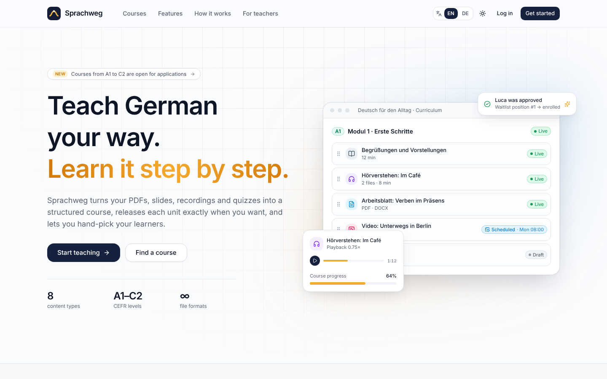 Landing page | 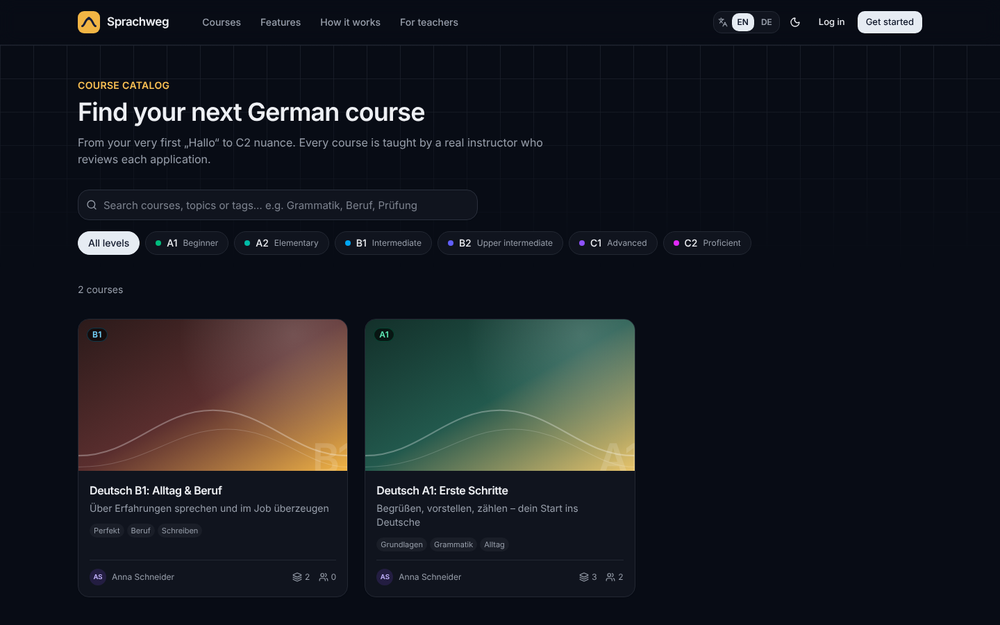 Catalog (dark) |
| 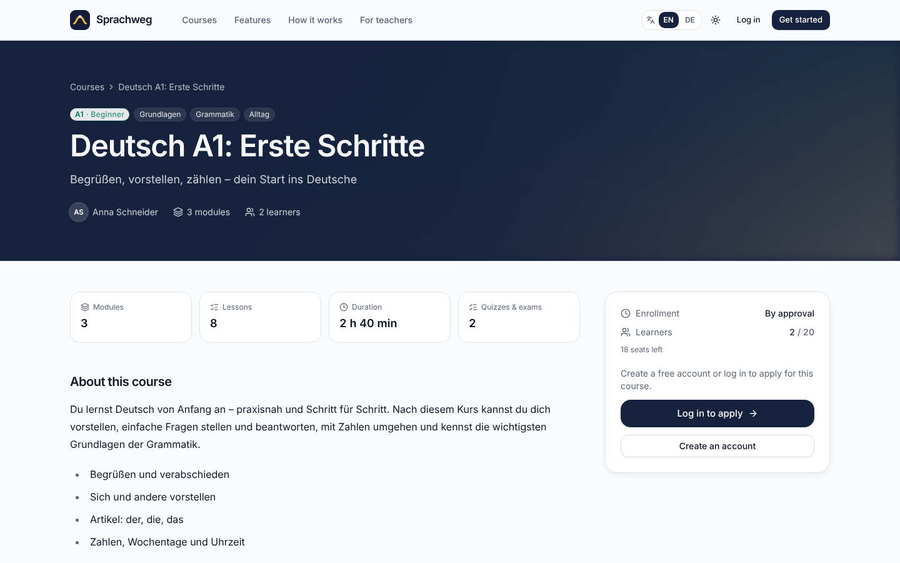 Course page | 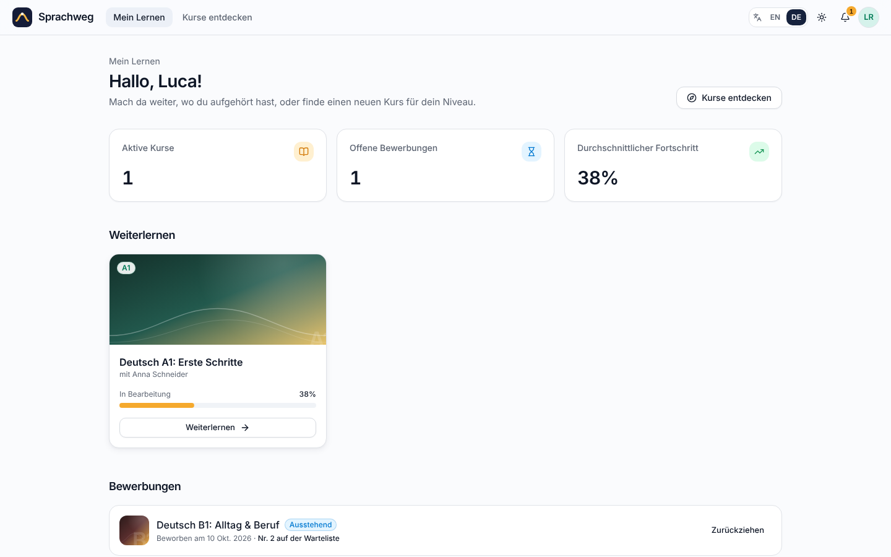 Student dashboard (de) |
| 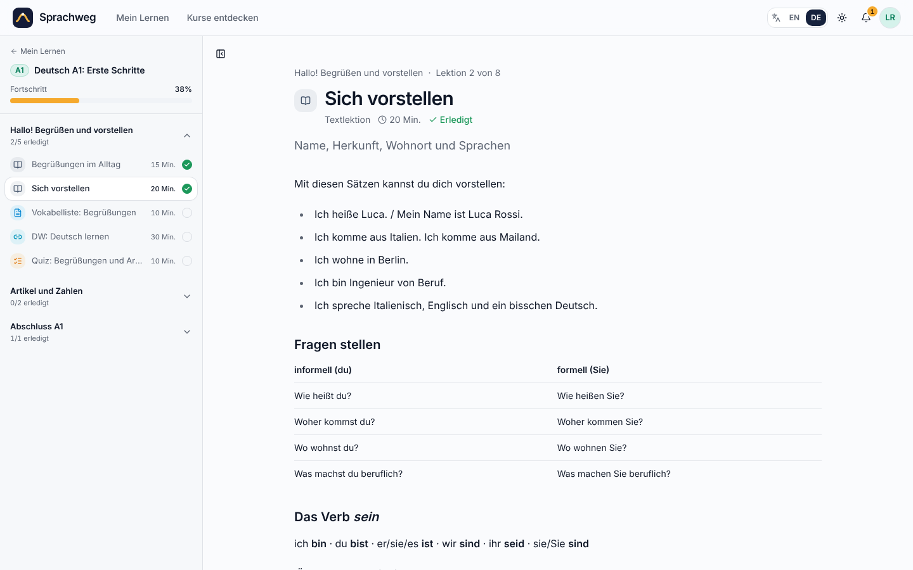 Learning player (de) | 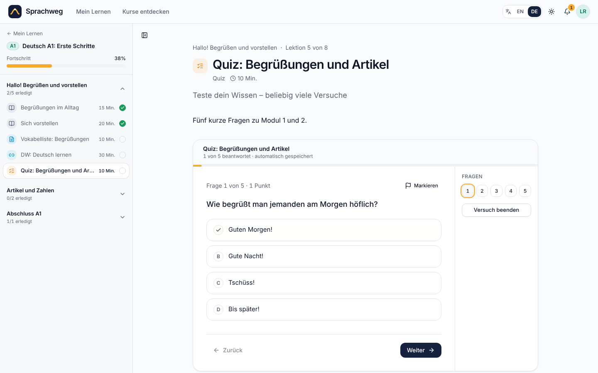 Quiz player (de) |
| 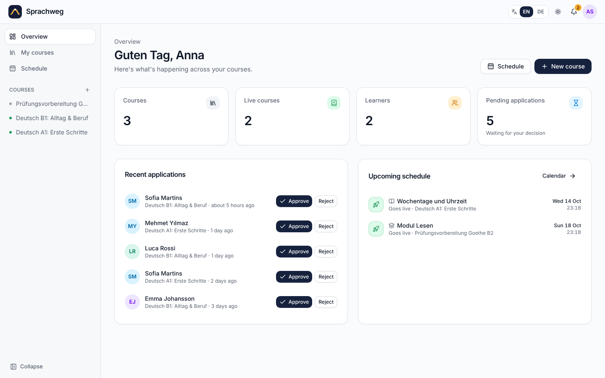 Instructor overview | 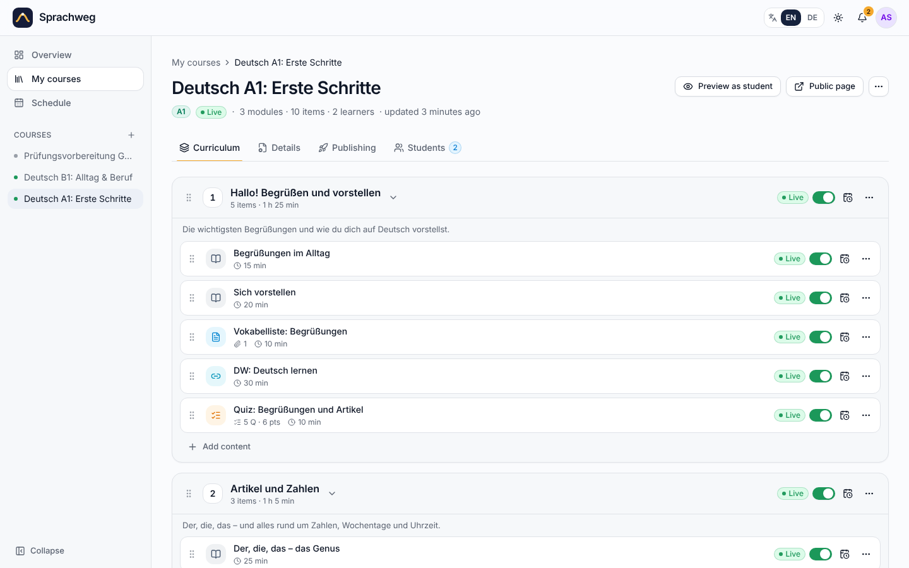 Course builder |
| 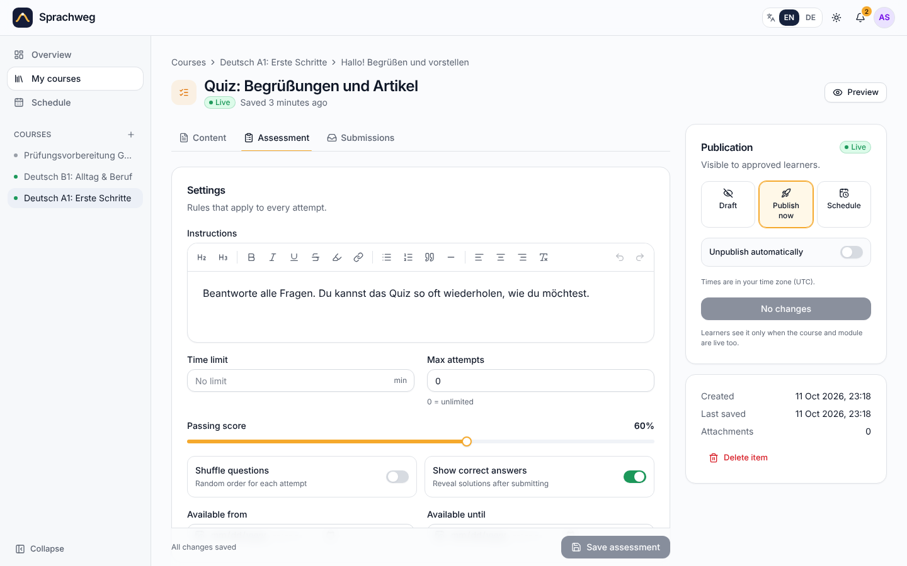 Quiz builder | 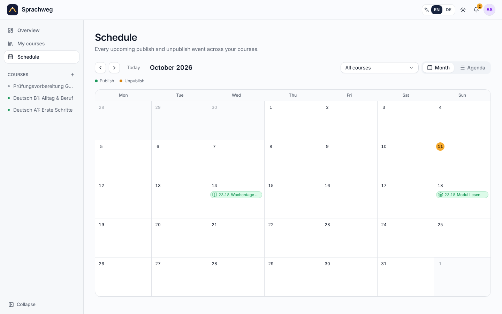 Schedule calendar |
| 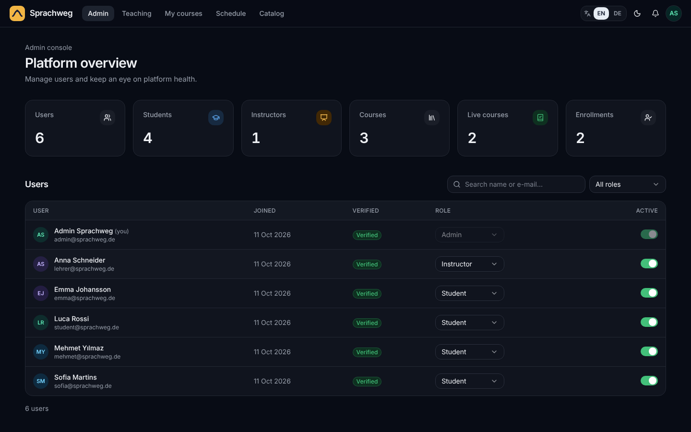 Admin (dark) | 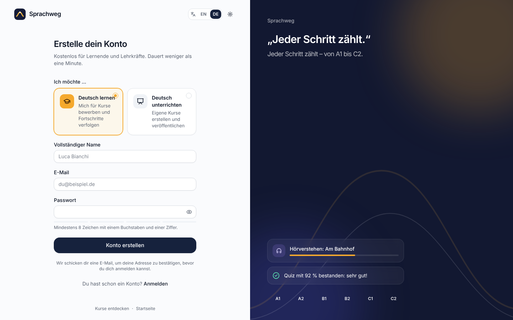 Registration (de) |

Mobile: [landing](screenshots/13-landing-mobile-de.png) · [learning player](screenshots/14-learning-player-mobile-de.png) ·
[instructor overview](screenshots/15-instructor-dashboard-mobile-de.png)

## 7. Known limitations / follow-ups

The first pass listed six follow-ups. All of them are now fixed (#26–#31). Remaining notes:

* **Dev-only noise**: in `next dev`, React Query Devtools throws `Incorrect locale information` in headless
  Chromium and next-themes logs a script-tag warning. Neither occurs in the production build.
* **Access-token check** (#1) adds one primary-key lookup per authenticated request. That is fine at this scale; a short
  cache (or token versioning) could remove it later.
* **Embeds**: detection of embeddable providers is an allow-list (YouTube, Vimeo, Google Docs/Slides/Drive, H5P,
  LearningApps). Other sites that do allow framing are still shown as a link card.
* **Seed data**: the dev database must be deleted (`rm -rf backend/data`) to pick up the cleaned-up seed lessons.
